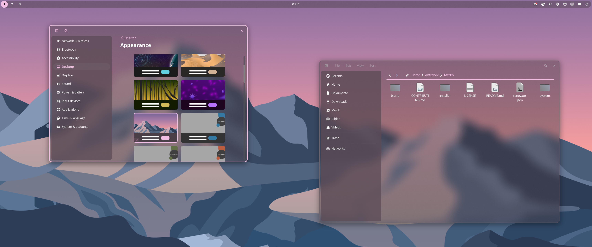
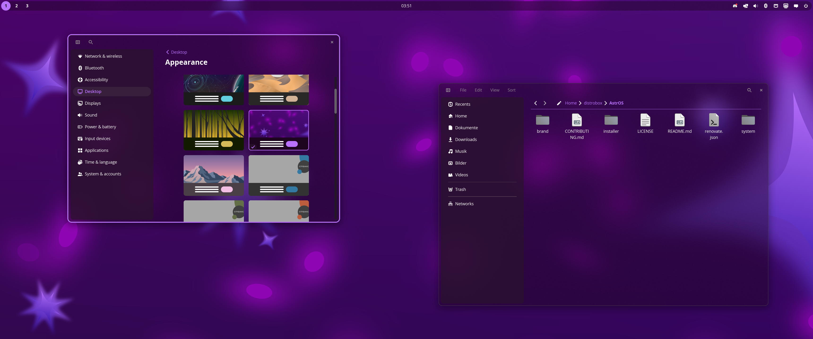
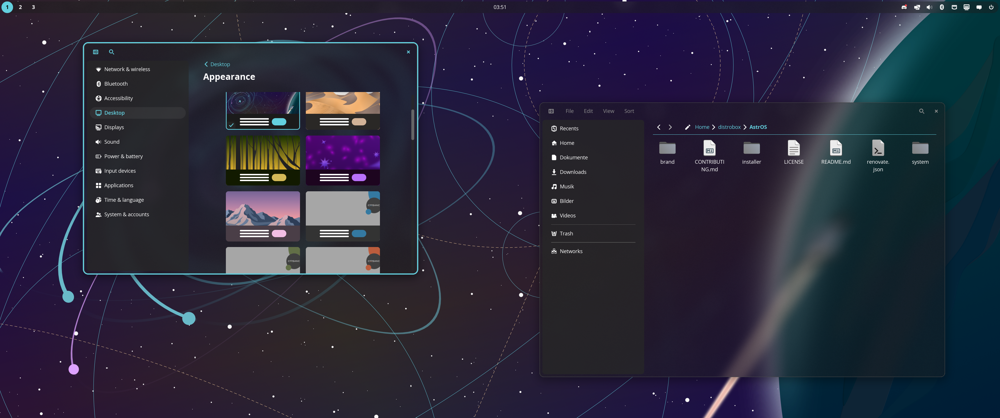
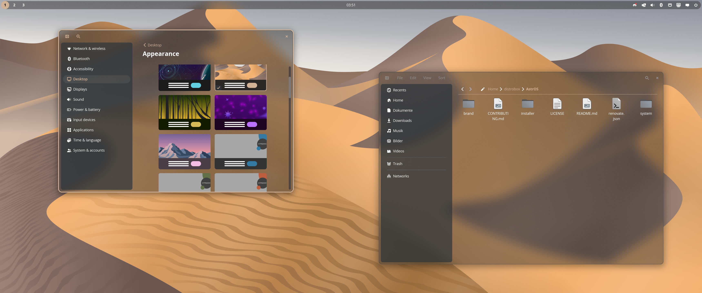
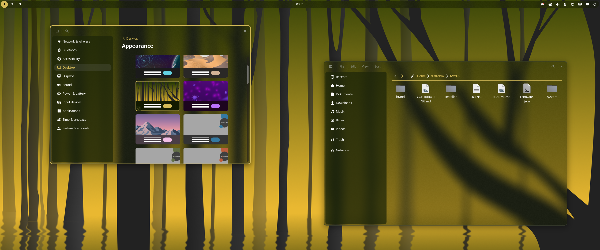
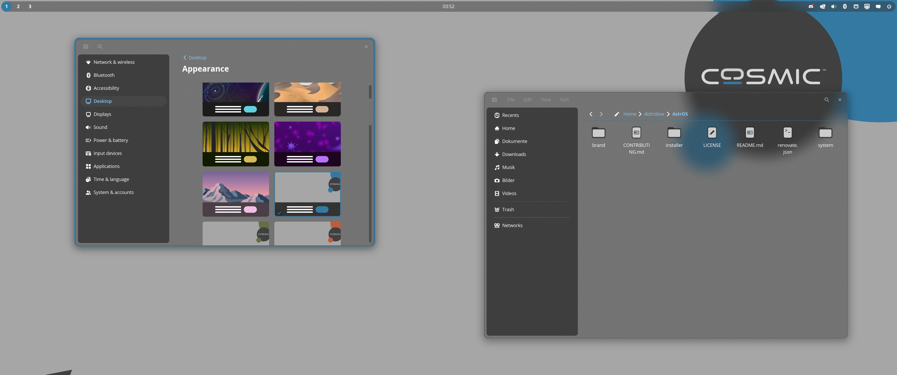

COSMIC 1.12 introduced theme bundles and AstrOS now ships them including our own bundle `Orbital Dark`.

A theme bundle is a complete look in one click. It bundles the wallpaper,
accent colors, icons and fonts. Eight official themes are available: COSMIC,
Dunes, Mirror Grove, Still Peaks, Universe Blue, Universe Green, Universe Orange, and Universe Red.

You can find them in **Settings > Desktop > Appearance**.

## Orbital Dark

Our own Orbital theme is now a bundle as well, and it sits right next to the
others as **Orbital Dark**. Picking it also sets the AstrOS wallpaper.

One thing changed with COSMIC 1.12: the first-boot setup now only offers
System76's own bundles, so Orbital isn't listed there anymore. Just pick it
in Settings after completing the initial setup.

## Eyecandy

*COSMIC Dark*

*Dunes Dark*

*Mirror Grove Dark*

*Universe Blue Dark*
